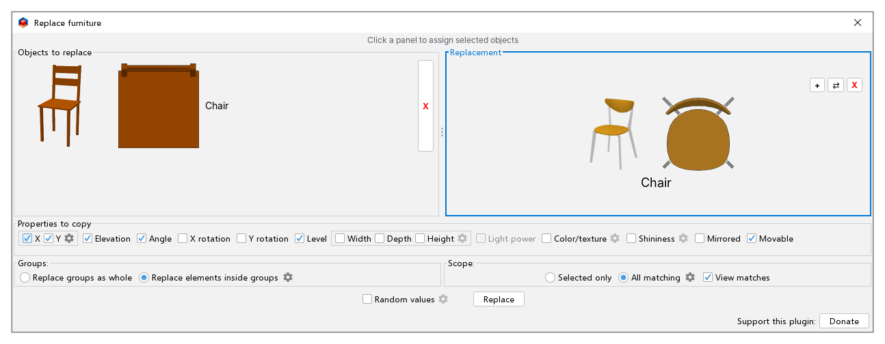
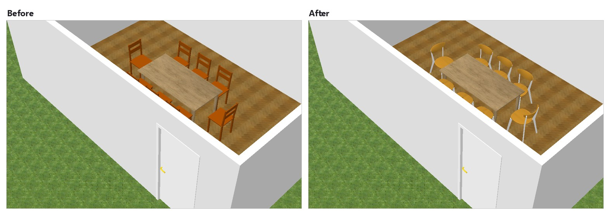

# Replacer

Replacer ("Replace furniture") is a plug-in for [Sweet Home 3D](https://www.sweethome3d.com) that replaces the selected furniture, or every matching piece in the home, with another piece, keeping the properties you choose to copy (position, angle, size, level, colors...).

## Features

- Two panels, "Objects to replace" and "Replacement"; the replacement can come from the plan or the catalog.
- Replacement groups: one object is picked at random for each replaced item, with weights.
- Match criteria for "All matching": 3D model and/or name, shininess tolerance, texture by name or by image, identical internal layout for groups. "View matches" highlights them in the plan.
- Colors and textures per material, from the original to the replacement.
- Properties to copy: position, elevation, level, angle, X/Y rotation, size, mirror, color, texture, shininess, light power and movable.
- Random values for any property, random mirror, and random colors/textures from a weighted list or by varying red, green and blue.
- Proportional scaling of unchecked dimensions and an anchor point (9 positions) when the sizes differ; doors and windows stay fitted to their wall opening.
- Groups replaced as a whole or the elements inside them, down to the subgroup depth you choose.
- Option to skip hidden or locked furniture.
- Interface in 19 languages.

## Download and installation

Download `Replacer-2.sh3p` from the [SourceForge ticket](https://sourceforge.net/p/sweethome3d/plug-ins/47/). Double-click it with Sweet Home 3D installed, or copy it into the Sweet Home 3D plug-ins folder and restart the application. Remove older Replacer versions from that folder first.

Requirements: Sweet Home 3D 6.5 or later and Java 8 or later.

## Building from source

This is a NetBeans (Ant) project. The generated folders (`build`, `dist`, `sh3d-dev`) and `nbproject/private` are not in the repository.

1. Put `SweetHome3D-7.5.jar` (the JAR version of Sweet Home 3D from its download page), `j3dcore.jar` and `vecmath.jar` (in `lib/java3d-1.6` of a Sweet Home 3D installation) in a `lib` folder at the root of the project, or set their paths in `nbproject/private/private.properties` with `file.reference.SweetHome3D-7.5.jar`, `file.reference.j3dcore.jar` and `file.reference.vecmath.jar`.
2. Open the folder in NetBeans and run Clean and Build. The plug-in is written to `dist/Replacer-<version>.jar`; rename it to `.sh3p` to install it.
3. Run and Debug start Sweet Home 3D with `sh3d-dev` as its preferences folder, and each compilation puts the plug-in in `sh3d-dev/plugins`.

To install the plug-in in your Sweet Home 3D on every build, add `sh3d.prod.plugins.dir=<path of its plugins folder>` to `nbproject/private/private.properties`.

> **Warning:** with `sh3d.prod.plugins.dir` set, every build deletes the `Replacer.jar`, `Replacer-*.jar`, `Replacer.sh3p` and `Replacer-*.sh3p` files of that folder and puts the new `Replacer-<version>.sh3p` in their place. `dist` and `sh3d-dev/plugins` are cleaned the same way.

## License

Copyright (c) 2023-2026 Oliver Martínez (Ollie_Jess).

Replacer is free software distributed under the GNU General Public License, version 3 or later. See [LICENSE](LICENSE). The replace icon (`src/replacer/replace.png`) comes from [Tabler Icons](https://tabler.io/icons) and is distributed under the MIT License; see [src/README2.TXT](src/README2.TXT). Sweet Home 3D is distributed separately under the GNU General Public License, version 2 or later.
